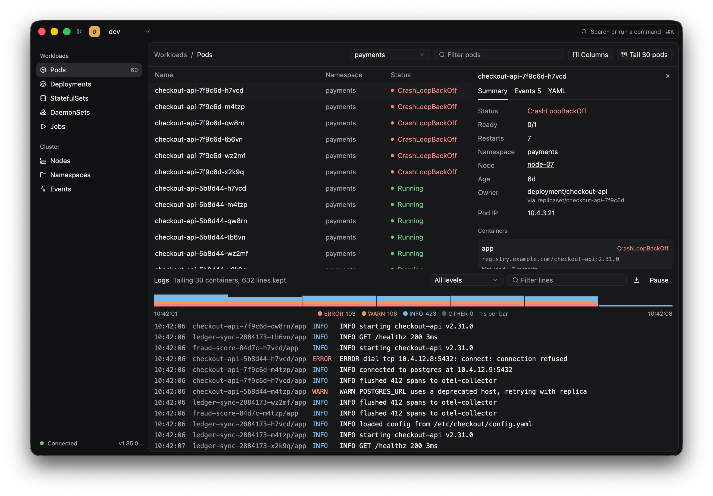

<p align="center">
  
</p>

<h1 align="center">Taffrail</h1>

<p align="center">
  A fast, read-only Kubernetes desktop console, built around live logs across many pods.
</p>

<p align="center">
  <a href="https://github.com/opikdev/taffrail/actions/workflows/ci.yml"></a>
  <a href="LICENSE"></a>
</p>

<p align="center">
  <a href="#build-from-source"><b>Build from source</b></a> ·
  <a href="docs/privacy.md">Privacy</a> ·
  <a href="docs/roadmap.md">Roadmap</a>
</p>

<p align="center">
  
</p>

Taffrail is a free, open source desktop app for macOS, Windows and Linux, written in Rust on GPUI. It helps you find what is wrong in a running cluster, starting from its logs. The name comes from the taffrail log, a ship's instrument trailed off the stern.

- **Live pod tables.** Pods update in place as they change, and the table stays smooth with thousands of them. Rows that need attention lead.
- **One merged log tail.** Tail up to 50 pods at once, in one view, with each line marked by its source.
- **Keyboard first.** Every action works from the keyboard, and the command palette finds any pod, command, context or namespace.

**Status:** early development. There are no releases yet, so [build it from source](#build-from-source). See [the roadmap](docs/roadmap.md) for what comes next.

## Your cluster stays yours

- **Read-only.** Taffrail lists, watches and reads. It never creates, changes or deletes anything in a cluster.
- **No account, analytics or telemetry.** Taffrail never sends anything to the people who make it.
- **It talks only to your clusters.** It connects to the API servers in your kubeconfig, and to nothing else.
- **Credentials stay in your kubeconfig.** Taffrail reads them from there and never copies, saves or logs them.

See the [privacy policy](docs/privacy.md) for exactly what it contacts and stores.

## Build from source

Install [rustup](https://rustup.rs/) and your platform's toolchain, as [Contributing](CONTRIBUTING.md#set-up) describes, then run:

```sh
git clone https://github.com/opikdev/taffrail.git
cd taffrail
cargo run --release --locked
```

`rust-toolchain.toml` installs the pinned Rust version on first use. Taffrail reads the kubeconfig named by `KUBECONFIG`, or `~/.kube/config`, and opens on the context you used last, or on the kubeconfig's current context.

## Docs

| For | Read |
|---|---|
| People using Taffrail | [Install](docs/install.md), [Privacy policy](docs/privacy.md), [Keyboard shortcuts](docs/design.md#keyboard), [Security policy](SECURITY.md) |
| Contributors | [Contributing](CONTRIBUTING.md), [AGENTS.md](AGENTS.md), [UI design](docs/design.md), [Preview the UI](docs/how-to/preview-the-ui.md), [Simulate a large cluster](docs/how-to/simulate-a-large-cluster.md), [Measure performance](docs/how-to/measure-performance.md) |
| Maintainers | [Roadmap](docs/roadmap.md), [Decisions](docs/decisions/): [ADR 001: Use GPUI with GPUI Kit](docs/decisions/001-use-gpui-with-gpui-kit.md), [ADR 002: Default to read-only with no telemetry](docs/decisions/002-read-only-with-no-telemetry.md), [ADR 003: Package with cargo-packager](docs/decisions/003-package-with-cargo-packager.md), [Release](docs/release.md), [Code signing](docs/code-signing.md) |

## Contribute

Issues and pull requests are welcome. Read [Contributing](CONTRIBUTING.md) and the [Code of conduct](CODE_OF_CONDUCT.md) first, and report security problems as [Security](SECURITY.md) describes, never in a public issue.

## License

[Apache-2.0](LICENSE)
